# Over-Engineering My Personal Platform (Because Why Not?)

I could have thrown together a basic template for this portfolio and called it a day. But where is the fun in that? 

I wanted a complete personal ecosystem—built with an extensible, bulletproof foundation ready to ingest whatever chaotic backend ideas I dream up in the future. The portfolio website is just one client application within this platform.

This architecture didn't appear overnight; it evolved through constant iteration. I originally started with a monolithic Python backend. I eventually rewrote it into a Go REST API for two reasons: I wanted to learn Go, and I wanted to eliminate the heavy runtime overhead of Python. On the frontend, my administrative dashboards went through two distinct iterations using JavaScript and Bun as I refined the UI patterns. 

While those monolithic REST APIs worked fine for a simple website, they presented a structural roadblock: if I wanted to build a completely separate project (like a financial ledger or a custom analytics engine), I would have to recreate authentication, rate-limiting, and core boilerplate all over again. I wanted to genuinely learn how to build distributed systems, and my personal platform was the perfect playground to do it.

So, I abandoned the monolithic REST approach entirely and built a strictly-typed microservice platform from scratch—extracting authentication and routing so any future service can plug into the grid for free. Here is how I wired together Go, gRPC, React, and a slightly paranoid PostgreSQL setup to make it happen.

---

## The Grand Plan

The architecture relies on absolute isolation. The frontends talk exclusively to a central API perimeter, which handles the dirty work before passing clean, binary payloads down to the internal backend services.

---

## The Perimeter: HAProxy & Fiber API Gateway

All external ingress traffic first passes through **HAProxy**, which sits at the absolute edge of the production infrastructure. It acts as the primary reverse proxy and entry point, handling:
* **TLS Termination & HTTPS Enforcement:** Automatically redirects HTTP to HTTPS (`*:443 ssl crt`) and manages SSL certificates.
* **Domain ACL Routing:** Routes traffic based on subdomains (`auth.api.adityapunmiya.com`, `manager.api.adityapunmiya.com`, `wallet.api.adityapunmiya.com`) directly to the backend gateway cluster. Any hostname it doesn't recognize gets a flat `404`.
* **Edge Compression & Headers:** Applies dynamic `gzip` compression for JSON/text responses and injects `X-Server` headers.
* **Health Checks & Telemetry:** Monitors backend availability via health checks. The stats page is welded to localhost and only reachable through an SSH tunnel, because a dashboard facing the open internet is an invitation.

The API gateway itself is built using Fiber, a ridiculously fast web framework for Go. 

The gateway executes exactly **zero** business logic. Its entire job is to keep the noise out. It intercepts incoming traffic, handles rate-limiting via Redis to stop script kiddies from spamming my endpoints, and manages two distinct authentication lanes:
* **The Admin Dashboards:** Authenticate via secure, Redis-backed session cookies. The `__Secure-session` cookie is scoped strictly to `api.adityapunmiya.com`, so the websites themselves never even see it.
* **The Public Portfolios:** Communicate via per-user API keys, stored only as SHA-256 hashes. A key can reach exactly five routes: four that read portfolio content and one that delivers contact messages. Everything else slams shut.

Yes, portfolios, plural. Anyone I give Manager access to can run their own portfolio on this platform, even from a completely different domain like `xyz.com`. They register that domain against their key in the Console, and the gateway opens a second, strictly cookie-free CORS lane just for it. An unregistered site gets nothing, and even a registered one can never ride on somebody's logged-in session.

Once a request passes the gauntlet, the gateway wraps the request in a 9.5-second deadline context (giving services a safe margin before HAProxy drops the connection), translates the JSON payload to Protobuf, and fires a lightweight binary gRPC call into the internal backend cluster.

---

## Internal Contracts via gRPC & Buf

When you split a monolith into microservices, keeping internal communication in sync across different codebases can quickly turn into a nightmare of broken endpoints and mismatched JSON. To kill this friction forever, the API gateway and internal backend services communicate strictly over gRPC using Protocol Buffers (`.proto`).

I manage all schemas centrally using **Buf**. It acts as the ultimate gatekeeper, handling linting and compiling the exact Go structs my services expect. To catch bad data before it even hints at touching my application logic, I use `protovalidate` to bake validation constraints directly into the raw `.proto` definitions. 

Right now, the cluster runs three isolated microservices, showcasing a true polyglot architecture:
* **Auth Service:** The central identity provider (Go). It handles SSO (Single Sign-On) for the entire ecosystem, decides who is allowed into which app, and issues/rotates API keys.
* **Manager Service:** The headless CMS (Go). It drives the CRUD operations for work experiences, portfolio projects, and incoming contact messages, with every row belonging to its own user.
* **Wallet Service:** The core financial ledger engine (C# / .NET). Manages balances, categories, and transaction histories via locked-down PostgreSQL stored procedures.
* **Future Services:** Because the Gateway and Auth layers are completely decoupled, I can drop a new service directly into the grid without touching the existing architecture.

And a private network is not a security strategy, so the gateway still has to prove itself. Every gRPC call carries a shared bearer token, and the services bind only to a private IP. If you aren't the gateway, the grid doesn't want to hear from you.

---

## Escaping the Denormalization Trap (Moving to PostgreSQL)

As the first real-world stress test of this platform, I migrated my public-facing website from a legacy MongoDB cluster to this new architecture. 

MongoDB was great for fast document reads, but it introduced a structural flaw: the denormalization trap. To avoid slow joins, MongoDB encourages embedding documents inside other documents. But when a piece of data changes, that update has to be manually propagated across multiple documents. 

Yes, modern MongoDB supports multi-document transactions to prevent data fracturing during network hiccups, and they work. But once your updates routinely span multiple documents, you are asking a document database to behave like a relational one, and paying for it in performance and complexity. My take: if you need all of that, use an RDBMS. Maintaining it on MongoDB was a hellhole I had no interest in managing.

Moving to PostgreSQL solved this immediately. Relational normalization means updating a single row propagates the change everywhere, instantly and safely, with native ACID compliance that doesn't tank system performance. 

It also allowed me to push the data processing closest to the data itself. Instead of making multiple database calls, dragging raw data across the network, and processing it in the application layer (or writing massive, unmaintainable MongoDB aggregation pipelines), I can execute a single SQL function directly on the server to get exactly what I need.

### Three Database Servers: A Self-Inflicted Wound

In the first version of this platform, Auth, Manager, and Wallet each got their very own PostgreSQL server. On a whiteboard, it looked gorgeous: pure isolation, textbook microservices, not a single shared byte.

In production, it was an absolute nightmare.

Three servers meant three rounds of version upgrades, three backup jobs to babysit, three sets of credentials to rotate, and three configurations to tune and then slowly watch drift apart. Worse, every one of them reserved its own slice of memory and CPU just to sit there looking busy. On hardware as modest as mine, that is a crime.

And that was only three. The whole point of this platform is dropping new services into the grid for free, except "free" now came with a brand new database server attached. Every future idea would have meant yet another instance to patch, back up, and lie awake worrying about. The architecture I built to make new services cheap was quietly making them expensive.

So I killed them. There is now **one PostgreSQL server and one database**, carved into logically separated schemas: `account` for Auth, `portfolio` for Manager, and `wallet` for Wallet. One thing to upgrade. One thing to back up. One pool of memory that actually gets used.

Nothing about this is free, and I won't pretend otherwise: if that one server goes down, everything goes down with it. For a personal platform, that is a trade I will happily make to get my weekends back. And the day a service genuinely outgrows this setup, its schema can be lifted out and moved to a server of its own.

### Paranoid Database Security
Merging the servers did not mean merging the trust. Every service still gets its own locked room: each role can only enter its own schema, so Manager has no business reading Wallet's ledger, and PostgreSQL makes sure it can't. Then, I took the security model to a slightly paranoid extreme. 

The application services connect to PostgreSQL using heavily restricted database roles (`auth_service`, `manager_service`, `wallet_service`). I explicitly **revoked `INSERT`, `UPDATE`, and `DELETE` permissions** from the tables. 

> **The Security Philosophy:** If the Go service is compromised, a malicious actor still cannot run arbitrary write queries or drop tables. 

Instead, all mutations are forced to route through tightly controlled, pre-compiled **PL/pgSQL stored procedures**. The application can only call specific execution paths. If it tries to write outside the lines, the database itself violently rejects it. The tables are created by a separate root role too, so the services don't even own the furniture.

### The Single-Tenant Constraint (Rest in Peace)

A previous version of this page proudly explained that the Auth schema hardcoded the user ID to `1`, physically guaranteeing that nobody else could ever exist in my system. That was by design. I was very smug about it.

Then I realized a portfolio CMS is a lot more useful when other people can use it too, so the constraint is gone. Auth now has real **role-based access control**: one administrator and any number of tenants, each granted only the apps they are allowed to open. Every Manager and Wallet row is tied to its owner, so one tenant can't go wandering through another's data.

What did not change is the paranoia about who gets in. Open registration still doesn't exist. Every account is created by hand from the Console, starts with a temporary password that expires in 7 days, and must pick a new one on first login. No sign-up form, no verification overhead, no rogue accounts.

---

## The Presentation Layer

The client infrastructure consists of four distinct React applications. To mirror the backend's separation of concerns, the administrative tools are cleanly split by domain:

* **Console UI:** The identity and operations dashboard. It acts as the SSO hub, routing requests through the gateway to the Auth service to manage active login sessions, user accounts, app access, and API key rotation. 
* **Manager UI:** The dedicated CMS dashboard. It handles the CRUD operations for the portfolio data once the gateway verifies the SSO session.
* **Wallet UI:** The dedicated financial tracking dashboard. Built with zero floating-point precision loss on balance calculations, because money that rounds itself is a horror story.
* **Portfolio:** The Next.js site you are reading this on. It pulls its content through the gateway with an API key and serves prerendered pages, so visitors aren't left waiting on my backend.

All admin interfaces are built for absolute speed: **React, Vite, and Bun**, with asynchronous caching handled flawlessly.

And when a project isn't ready for the public, it points to a tiny construction page: plain HTML and a few hundred bytes of JavaScript, because not everything deserves a framework. Not even on a platform this over-engineered.

---

## Bare-Metal Deployment

While Kubernetes is the industry standard for container orchestration, running its control plane introduces unnecessary architectural complexity. I wanted absolute simplicity and engineering efficiency. Therefore, the deployment pipeline is built for bare-metal efficiency using GitHub Actions and Podman.

Currently, every service follows a standardized CI/CD workflow. When a deployment is triggered, GitHub Actions builds the image, pushes it to the GitHub Container Registry (GHCR), and SSHs directly into the target virtual machine to orchestrate the rollout. Exposing an SSH port for an external CI runner is a temporary, pragmatic trade-off, but the container execution itself remains heavily locked down.

Noticeably, I do not run the Docker daemon on my servers; I use **Podman**. 

Because Podman is daemonless and integrates natively with Linux `systemd`, it eliminates background overhead. More importantly, it allows me to enforce strict, unyielding service boundaries. When the deployment script spins up a service, the container is strictly isolated, physically preventing cross-service interference. Containers get a read-only filesystem, every Linux capability dropped, and a hard memory ceiling. Images are tagged with the exact commit they came from, and if a new container dies on startup, the pipeline rolls back to the previous one on its own.

Every piece gets a machine of its own. The gateway, each backend service, and PostgreSQL all run on separate hosts and talk over a private network, so a runaway service can't starve its neighbors. Redis lives on the same self-hosted infrastructure, because I apparently enjoy owning things.

---

## Logging & Telemetry

For observability, I intentionally avoided deploying complex stacks. Because Podman integrates directly with the OS, all container output is natively piped into the system journal. If I need to trace a failed gRPC request or audit a rate limit, I simply query `journalctl`. It is fast, built-in, and inherently elegant.

---

## Future Roadmap & System Evolution

With the HAProxy/Fiber perimeter, gRPC polyglot microservice grid, and zero-trust storage fully operational, future iterations will focus on infrastructure hardening, advanced telemetry, and resilience:

* **Bastion Host Deployment:** Severing direct SSH ingress access to production VMs by routing all GitHub Actions image deployments strictly through an isolated bastion host.
* **Centralized Telemetry:** Migrating from terminal journal logs (`journalctl`) to a centralized **Grafana, Loki, and VictoriaMetrics** observability stack as cluster traffic scales.
* **Distributed Resilience Patterns:** Enhancing the Gateway and service layers with dynamic P95-based timeouts, circuit breaker feedback loops, and retry budgets.

---

## The Source Code

The architecture is entirely open-source. You can explore the exact implementations, gRPC contracts, and deployment setups across the cluster repositories:

**Infrastructure & Contracts**
* [`common`](https://github.com/Aditya-0011/common) - The centralized Protocol Buffer contracts, generated Go/C# structs, and shared middleware.
* [`gateway`](https://github.com/Aditya-0011/gateway) - The Fiber-based API perimeter, rate limiter, and gRPC translator.

**Backend Microservices**
* [`auth-service`](https://github.com/Aditya-0011/auth-service) - The identity provider, SSO hub, and API key manager (Go).
* [`manager-service`](https://github.com/Aditya-0011/manager-service) - The headless CMS backend powering the portfolio data (Go).
* [`wallet-service`](https://github.com/Aditya-0011/wallet-service) - The core financial ledger engine (C# / .NET).

**Client Applications**
* [`portfolio-website`](https://github.com/Aditya-0011/portfolio-website) - The source code for this exact Next.js portfolio website.
* [`console-ui`](https://github.com/Aditya-0011/console-ui) - The identity and systems operations dashboard.
* [`manager-ui`](https://github.com/Aditya-0011/manager-ui) - The dedicated CMS content dashboard.
* [`wallet-ui`](https://github.com/Aditya-0011/wallet-ui) - The financial tracking dashboard.
* [`construction-global`](https://github.com/Aditya-0011/construction-global) - The deliberately tiny page for anything still being built.
